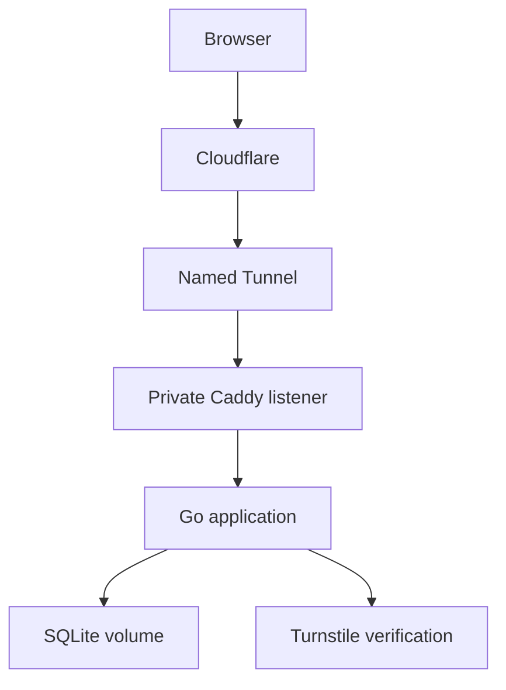

# Little Garden architecture

## One process, one active garden

The frontend is a React shell around an independent Canvas renderer. Pointer movement and animation never update React state per frame. Flowers are `{ id, gardenId, x, y, seed, palette, styleVersion, createdAt }`; the server generates the ID, seed and time. World coordinates are 2400 × 1600. Every viewer renders the same seed using version 1 of the flower recipe.

Go owns the state. A single garden coordinator serializes commits, snapshots and broadcasts. SQLite uses WAL, FULL synchronous mode, one connection per serving process, a 5-second busy timeout and a 64 MiB page-count ceiling. A process file lock prevents accidentally running two garden servers against one database. The supported deployment is one replica on local disk.

The Docker image embeds the built Vite assets with `go:embed`. Caddy and Go share the same public origin through the tunnel. Static hashed assets may be cached; session, garden and WebSocket routes must not be cached by a CDN rule.

## Planting protocol

1. The browser picks a location and a UUID request ID. Its local pending flower is only visual feedback.
2. Go validates Origin, the signed anonymous cookie, rate budgets, body size, coordinates, palette, garden ID, spacing and capacity.
3. Under the coordinator lock, `(visitor_id, request_id)` is looked up. An identical retry returns the existing flower. Reusing a request ID for different input returns a conflict.
4. One SQLite transaction inserts the flower and increments the revision. A failed commit produces no cache change or event.
5. Only after commit, the in-memory state changes and a `flower` event is enqueued for subscribers.
6. HTTP acknowledgement and WebSocket event can arrive in either order. The client deduplicates by flower ID; only ordered WebSocket events advance the revision. A revision gap reconnects for a full snapshot.

The idempotency guarantee is scoped to the same anonymous session. Network retries reuse the request ID. After a session expires, it cannot authorize more writes. Banning a session also prevents replaying its old requests.

## HTTP API

| Route | Behavior |
| --- | --- |
| `GET /api/v1/garden` | Current snapshot plus public Turnstile site key and development flag |
| `GET /api/v1/session` | Whether the existing cookie still authorizes planting; expiry only, no visitor ID |
| `POST /api/v1/session` | Validate `{token}` and issue a 24-hour HttpOnly cookie |
| `POST /api/v1/flowers` | `{gardenId,requestId,x,y,palette}` → authoritative flower and revision |
| `GET /api/v1/ws` | Exact-Origin WebSocket; initial snapshot followed by committed events |
| `GET /healthz` | Process liveness |
| `GET /readyz` | Database availability |

Errors use `{ "error": "rate_limited", "retryAfter": 3 }`, with an HTTP `Retry-After` header when appropriate. Common codes: `too_close`, `garden_changed`, `garden_full`, `garden_paused`, `session_required`, `verification_failed`, `server_busy`.

## WebSocket ordering and limits

Subscribing and enqueuing the initial snapshot happen under the same lock as plant commits. An observer therefore receives a committed flower either in its snapshot or after it, with no gap between those operations.

Each subscriber has a 32-message queue. A full queue closes the subscription rather than blocking the garden. Writes have 5-second deadlines. Heartbeats run every 25 seconds; an individual connection rotates after 30 minutes. Inbound application messages are rejected: all planting happens through bounded HTTP POSTs. Reconnects use exponential backoff and jitter and receive a new full snapshot, which is bounded by the garden capacity.

Moderation and garden rotation broadcast a complete replacement snapshot. Hidden flowers still consume capacity. Up to 30 gardens are retained; rotation stops at that ceiling rather than deleting historical data. Export/archive policy and an archive browsing UI can be added when needed.

## Verification

Go integration tests exercise real SQLite files and real HTTP/WebSocket connections: simultaneous retries, atomic snapshot subscription, commit failure, restart recovery, backups including WAL writes, forged cookies, Origin checks, forwarded-IP trust, Turnstile replay/hostname/action validation, write limits, connection caps and rejected inbound WebSocket messages. Frontend state tests cover delivery order, gaps and moderation races.

Turnstile tests use a deterministic mock of Siteverify. Real Cloudflare account setup and live browser verification must be checked against the final domain before launch.
